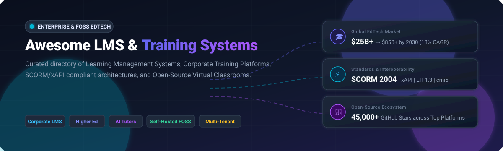

  

# 🎓 Awesome Learning Management System (LMS) &amp; Training

  
  
  

> 📚 A curated directory of top **Learning Management Systems (LMS)**, **Corporate Training Platforms**, **Course Authoring Engines**, and **Open-Source eLearning Architectures** for delivering courses, tracking learner certifications, and scaling organizational education.
>
> 🌟 Star this repo if you find it useful! 🌟

---

## 📋 Table of Contents

- [🌐 Sector Overview &amp; Market Dynamics](#-sector-overview--market-dynamics)
- [🏢 Enterprise SaaS &amp; Hosted Platforms](#-enterprise-saas--hosted-platforms)
- [🔓 Open-Source Software &amp; Frameworks](#-open-source-software--frameworks)
- [📊 Feature Comparison Matrix](#-feature-comparison-matrix)
- [🎯 Key Selection Criteria for LMS &amp; Training](#-key-selection-criteria-for-lms--training)
- [⭐ Star History](#-star-history)
- [💖 Support](#-support)
- [🤝 Contributing](#-contributing)
- [📄 License](#-license)

---

## 🌐 Sector Overview &amp; Market Dynamics

The global Learning Management System (LMS) market was valued at approximately **$20.6 billion to $24.8 billion in 2024** and is projected to expand to over **$82.5 billion by 2030**, compounding at an estimated CAGR of **18.1% to 19.5%**. This explosive growth is accelerated by remote and hybrid workforce training, continuous corporate compliance mandates, generative AI-driven adaptive learning paths, and digital transformation in higher education and K-12 schooling.

Market concentration follows a **moderately fragmented structure** rather than a winner-take-all monopoly. While enterprise cloud heavyweights (such as Cornerstone OnDemand, SAP SuccessFactors/Litmos, and Docebo) and academic leaders (Instructure Canvas, Anthology Blackboard) capture substantial corporate and institutional budgets, thousands of agile SaaS platforms (TalentLMS, 360Learning, LearnUpon) and vibrant open-source communities (Moodle, Open edX, Frappe LMS) actively compete by catering to specialized niches like customer training, collaborative peer learning, and self-hosted data sovereignty.

---

## 🏢 Enterprise SaaS &amp; Hosted Platforms

The table below lists leading commercial LMS and corporate training platforms, sorted in descending order by company valuation or parent acquisition scale.

| Platform 🏢 | Valuation / Market Scale 💰 | Starting Pricing Tier 💵 | Free Tier / Trial Limit 🎁 | Deployment Type ☁️ | Primary Focus &amp; Target Audience 🎯 |
| :--- | :--- | :--- | :--- | :--- | :--- |
| **[Cornerstone OnDemand](https://www.cornerstoneondemand.com/)** | **~$5.2 Billion** (Private Equity Acquisition) | **$3.50 – $8.00 / user / month** (PEPM, quote-based by scale) | **No Free Trial / Free Tier**: Sales-led guided demo and sandbox upon qualification | Cloud SaaS / Multi-tenant | Enterprise HCM, workforce intelligence, talent management &amp; compliance |
| **[Litmos](https://www.litmos.com/)** | **~$1.0+ Billion** (Acquired by Francisco Partners) | **$8,000 / year** (Foundation Tier base minimum) | **14-Day Free Trial**: Full self-serve evaluation with courses &amp; workflows | Cloud SaaS | Corporate training, rapid content authoring &amp; partner certifications |
| **[Docebo](https://www.docebo.com/)** | **~$800 Million** (Public NASDAQ: DCBO / $268M Rev) | **$35,900 / year** (Elevate tier, includes 500 YAU) | **No Free Tier / Free Trial**: Sales-assisted guided demo &amp; bespoke pilot sandbox | Cloud SaaS / Multi-tenant | Mid-market &amp; enterprise AI learning paths, social learning &amp; CRM integration |
| **[Absorb LMS](https://www.absorblms.com/)** | **~$500 Million** (Acquired by WCAS PE / ~$69M ARR) | **$14,500 / year** (Base entry deployment, ~500 users) | **Free Demo Portal / Pilot**: No self-serve plan; temporary sales-led test tenant | Cloud SaaS | Mid-market to enterprise compliance, customer enablement &amp; training sales |
| **[360Learning](https://360learning.com/)** | **~$400 Million** (SoftBank/Silver Lake / ~$60M Rev) | **$8 / user / month** (Team Plan, up to 100 users) | **30-Day Free Trial**: Team plan self-serve trial; no credit card required upfront | Cloud SaaS | Collaborative learning, peer course authoring &amp; internal upskilling |
| **[LearnUpon](https://www.learnupon.com/)** | **~$100M+ Funded** (Summit Partners / ~$40M ARR) | **$10,000 / year** (~$6 – $9 / user / mo, min 100 users) | **No Free Tier / Trial**: Sales-led personalized demo; pilot portals on request | Cloud SaaS / Multi-portal | Customer onboarding, partner academies, associations &amp; external training |
| **[TalentLMS](https://www.talentlms.com/)** | **Private / Bootstrap-Scaled** (Epignosis subsidiary) | **$119 / month** (Core Plan billed annually, up to 40 users) | **Free Forever Plan**: Up to **5 active users** &amp; **10 courses** (no expiration) | Cloud SaaS | Small-to-midsize businesses (SMBs), rapid course setup &amp; onboarding |

---

## 🔓 Open-Source Software &amp; Frameworks

Community-driven, self-hosted LMS solutions providing full data sovereignty, zero per-seat licensing fees, and extensibility. Sorted in descending order by GitHub stargazers.

| Project 🔓 | GitHub_Stars ⭐ | Stack 🛠️ | License 📄 | Compliance &amp; Standards 📜 | Key Differentiators 💡 |
| :--- | :--- | :--- | :--- | :--- | :--- |
| **[BigBlueButton](https://github.com/bigbluebutton/bigbluebutton)** |  | Scala, Java, Node.js, WebRTC | LGPL-3.0 | LTI 1.3, Canvas/Moodle Plugin | Real-time virtual classroom system with interactive whiteboards, breakout rooms, and session recording |
| **[Open edX](https://github.com/openedx/openedx-platform)** |  | Python, Django, React | AGPL-3.0 | xAPI, LTI 1.1/1.3, XBlocks | The MOOC-scale platform created by MIT and Harvard powering edX.org, capable of millions of learners |
| **[Moodle](https://github.com/moodle/moodle)** |  | PHP, MariaDB/PostgreSQL | GPL-3.0 | SCORM 1.2/2004, LTI, Badges | World’s most widely deployed institutional LMS with 2,000+ plugins, 40+ quiz question types, and global support |
| **[Canvas LMS](https://github.com/instructure/canvas-lms)** |  | Ruby on Rails, React | AGPL-3.0 | LTI Advantage, Common Cartridge | The open core behind Instructure Canvas, featuring best-in-class UI/UX, SpeedGrader, and mobile integration |
| **[Frappe LMS](https://github.com/frappe/lms)** |  | Python, Frappe, Vue.js | GPL-3.0 | REST API, Webhooks | Modern, lightweight, 100% open-source LMS seamlessly integrated with the ERPNext enterprise ecosystem |
| **[Learnhouse](https://github.com/learnhouse/learnhouse)** |  | Python, FastAPI, Next.js | AGPL-3.0 | REST API, Docker | Next-generation modern learning platform focused on sleek developer UX, rapid course publishing, and markdown support |
| **[ClassroomIO](https://github.com/classroomio/classroomio)** |  | SvelteKit, Supabase, PostgreSQL | MIT | xAPI / Webhooks | Customer training and enablement platform built for SaaS companies to drive product education and retention |
| **[CourseLit](https://github.com/codelitdev/courselit)** |  | TypeScript, Node.js, Next.js | AGPL-3.0 | Stripe / PayPal / Webhooks | Self-hosted creator academy alternative to Teachable/Thinkific with built-in payments, blogging, and digital products |
| **[Sakai](https://github.com/sakaiproject/sakai)** |  | Java, Spring, React | ECL-2.0 | IMS LTI 1.3, SCORM 2004 | Higher-education collaboration suite and enterprise academic LMS supported by leading international universities |
| **[Tutor (Open edX)](https://github.com/overhangio/tutor)** |  | Python, Docker, Compose | AGPL-3.0 | Open edX Ecosystem | Official Docker and Kubernetes orchestrator for Open edX deployment, maintenance, and multi-tenant clustering |
| **[Chamilo](https://github.com/chamilo/chamilo-lms)** |  | PHP, MariaDB, Symfony | GPL-3.0 | SCORM 1.2, xAPI, LTI | Accessible, user-friendly alternative to Moodle designed for easy teacher onboarding and low-bandwidth environments |
| **[Pupilfirst](https://github.com/pupilfirst/pupilfirst)** |  | Ruby on Rails, Rescript, React | Apache-2.0 | GraphQL API | Asynchronous online school and vocational bootcamp engine driven by task evaluations, reviews, and community |
| **[Sensei LMS](https://github.com/Automattic/sensei)** |  | PHP, WordPress, React | GPL-2.0 | WooCommerce, WordPress Hook | Native WordPress LMS plugin developed by Automattic for building, managing, and selling courses |
| **[ILIAS](https://github.com/ILIAS-eLearning/ILIAS)** |  | PHP, MySQL, Lucene | GPL-3.0 | SCORM 1.2/2004, LTI | Heavy-duty compliance, competency management, and assessment platform popular in European government and universities |
| **[TutorLoom](https://github.com/pacewisdomhq/TutorLoom)** |  | Django, React, Celery, Flutter | Apache-2.0 | OpenAPI / Swagger | Multi-tenant training institute system with trainer/student portals, progress tracking, and a companion Flutter app |
| **[Euron Open LMS](https://github.com/euron-sde-team/euron-open-lms)** |  | TypeScript, Node.js, React Native | Open Source | Stripe, Razorpay, HLS Video | Video-centric LMS with offline encrypted mobile playback, verifiable certificates, and cloud infrastructure as code |

---

## 📊 Feature Comparison Matrix

| Platform / Tool | Type | SCORM / xAPI Support | Native Mobile App | Self-Hosted Option | Top Use Case |
| :--- | :--- | :--- | :--- | :--- | :--- |
| **Cornerstone OnDemand** | SaaS | ✅ SCORM / xAPI / AICC | ✅ iOS &amp; Android | ❌ Managed Cloud | Enterprise workforce planning &amp; HCM compliance |
| **Litmos** | SaaS | ✅ SCORM 1.2/2004, xAPI | ✅ iOS &amp; Android | ❌ Managed Cloud | Corporate compliance &amp; rapid sales training |
| **Docebo** | SaaS | ✅ SCORM, xAPI, cmi5 | ✅ iOS &amp; Android | ❌ Managed Cloud | AI-curated personalized enterprise learning |
| **Absorb LMS** | SaaS | ✅ SCORM, xAPI, AICC | ✅ Absorb Learn | ❌ Managed Cloud | Mid-market employee training &amp; external selling |
| **360Learning** | SaaS | ✅ SCORM 1.2/2004 | ✅ iOS &amp; Android | ❌ Managed Cloud | Peer-to-peer collaborative knowledge sharing |
| **LearnUpon** | SaaS | ✅ SCORM, xAPI, Tin Can | ✅ iOS &amp; Android | ❌ Managed Cloud | Multi-portal customer education &amp; academies |
| **TalentLMS** | SaaS | ✅ SCORM 1.2/2004, xAPI | ✅ TalentLMS App | ❌ Managed Cloud | Fast SMB course publishing &amp; team onboarding |
| **BigBlueButton** | FOSS | 🔄 Integrated into LMS | ✅ WebRTC Responsive | ✅ Self-Hosted | Real-time virtual classrooms &amp; tutoring sessions |
| **Open edX** | FOSS | ✅ xAPI via XBlocks | ✅ iOS &amp; Android SDK | ✅ Self-Hosted / Tutor | Higher-ed MOOCs &amp; automated code grading |
| **Moodle** | FOSS | ✅ Full SCORM &amp; LTI | ✅ Moodle Mobile | ✅ Self-Hosted / Docker | Full-featured institutional &amp; enterprise LMS |
| **Canvas LMS** | FOSS | ✅ LTI 1.3 / Cartridge | ✅ Canvas Student/Teacher | ✅ Self-Hosted Core | Modern higher-ed &amp; K-12 academic workflow |
| **Frappe LMS** | FOSS | 🔄 Via REST / Frappe | ❌ Responsive Web | ✅ Self-Hosted Core | ERPNext-connected internal corporate academy |
| **Learnhouse** | FOSS | 🔄 Webhooks / Markdown | ❌ Responsive Web | ✅ Self-Hosted / Docker | Fast developer-first educational content |
| **ClassroomIO** | FOSS | 🔄 Webhooks &amp; Events | ❌ Responsive Web | ✅ Self-Hosted Core | Customer product training &amp; SaaS adoption |
| **CourseLit** | FOSS | 🔄 Video / Content CMS | ❌ Responsive Web | ✅ Self-Hosted / Node | Independent creators selling course subscriptions |
| **Sakai** | FOSS | ✅ SCORM 2004, LTI 1.3 | ❌ Responsive Web | ✅ Self-Hosted / Java | Academic university research &amp; course portals |
| **Chamilo** | FOSS | ✅ SCORM 1.2 | ❌ Responsive Web | ✅ Self-Hosted / PHP | Lightweight, low-overhead school deployments |
| **Pupilfirst** | FOSS | 🔄 Task Workflow API | ❌ Responsive Web | ✅ Self-Hosted / Ruby | Asynchronous project-based bootcamps &amp; review |
| **Sensei LMS** | FOSS | 🔄 Via WP Plugins | ❌ WordPress Web | ✅ Self-Hosted / WP | WordPress site owners monetizing digital courses |
| **ILIAS** | FOSS | ✅ SCORM 1.2/2004, LTI | ❌ Responsive Web | ✅ Self-Hosted / PHP | European enterprise compliance &amp; certification |
| **TutorLoom** | FOSS | 🔄 REST API | ✅ Flutter App | ✅ Self-Hosted / Django | Multi-tenant training institutes &amp; academies |
| **Euron Open LMS** | FOSS | 🔄 HLS DRM / REST | ✅ React Native (Offline) | ✅ Self-Hosted / TS | Video streaming platforms &amp; mobile learners |

---

## 🎯 Key Selection Criteria for LMS &amp; Training

When evaluating a Learning Management System for your organization, prioritize these essential evaluation pillars:

1. **Learning Standards &amp; Interoperability** 📜: Ensure native support for **SCORM (1.2 / 2004)**, **xAPI (Experience API / Tin Can)**, **cmi5**, and **LTI (Learning Tools Interoperability 1.3)** to prevent course vendor lock-in and enable third-party content imports.
2. **Delivery Architecture (SaaS vs. Self-Hosted)** 🏗️: Choose commercial SaaS (TalentLMS, Docebo, Litmos) when you require zero infrastructure maintenance and turn-key compliance. Choose open-source (Moodle, Open edX, Canvas LMS, Frappe LMS) when strict data privacy, HIPAA/GDPR regulatory custody, or unlimited seat scaling is mandatory.
3. **Audience Segmentation &amp; Multi-Tenancy** 🏢: If training both internal staff and external clients/dealers, verify whether the platform supports independent white-labeled sub-portals with distinct branding and catalogs (e.g., LearnUpon, Cornerstone, TutorLoom).
4. **Mobile Learning &amp; Offline Consumption** 📱: High completion rates depend on intuitive mobile apps with push reminders and offline DRM content download capabilities (e.g., Moodle App, Canvas Student, Euron Open LMS).
5. **AI Authoring &amp; Assessment Automation** 🤖: Modern LMS platforms dramatically cut course development cycles by using AI to auto-generate video chapters, flashcards, knowledge checks, and localized multi-language subtitles.

---

##  Star History

---

## 💖 Support

Thank you for visiting and using this curated directory! If you find this project valuable for your team's learning infrastructure, please consider supporting it:

- ⭐ **Star this repository** to improve discoverability for educators, architects, and engineering leaders
- 🍴 **Fork and contribute** new open-source platforms, innovative training tools, or deployment guides
- 📢 **Share** this collection with your EdTech, HR Tech, and DevOps communities
- ☕ **Sponsor**: Support ongoing curation of open-source knowledge bases via [GitHub Sponsors](https://github.com/sponsors/ishandutta2007)

---

## 🤝 Contributing

Contributions are warmly welcomed! 🙌 If you know of an innovative open-source LMS, video learning system, or training tool that belongs on this list:

1. 🍴 **Fork this repository**
2. 🌿 **Create a feature branch** (`git checkout -b feature/add-new-lms-tool`)
3. ✍️ **Add the tool** with precise details (Stack, License, Stars_Badge linked to stargazers, key differentiators)
4. 💾 **Commit your changes** (`git commit -m 'Add new open-source LMS tool'`)
5. 🚀 **Push to the branch** (`git push origin feature/add-new-lms-tool`)
6. 📬 **Submit a Pull Request**

---

## 📄 License

This repository is distributed under the [CC0 1.0 Universal (Public Domain)](https://creativecommons.org/publicdomain/zero/1.0/) license. Individual products, software packages, and tools mentioned retain their respective copyrights and licensing terms.

---

  <b>⭐ If this guide helps your educational architecture or corporate training strategy, please star the repository! ⭐</b>

